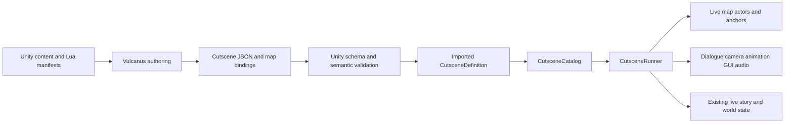

# Vulcanus cutscenes: authoring, interchange, and Unity runtime specification

Status: proposed design, not an implemented feature. Repository review: 22 October 2026.

This proposal is for UrdewValley / Roemer's existing 2D Unity game. It specifies both the Vulcanus export contract and the Unity implementation needed to play it. The checkout contains Vulcanus exports and schemas, but not the external editor's implementation. Vulcanus UI requirements below are proposals; they are not claims about features already available there.

## 1. Goal and concrete first use case

An author should be able to create a short scene in Vulcanus, export it alongside a map and dialogues, and play it in Unity without writing a new MonoBehaviour or wiring each cutscene into a manager.

The reference slice is a first-visit introduction: the player enters a map trigger, ordinary interaction stops, the calendar pauses, the camera frames an NPC, that NPC walks to a map anchor, an existing Vulcanus dialogue plays, a short reaction animation and sound run together, the camera returns, and a saved story flag prevents the introduction from repeating. The NPC is already placed in the map. This proves the actual integration before adding cinematic spawning, rewards, cross-map scenes, or arbitrary scripting.

The result should support short in-world conversations and staged story moments. It is not initially a film editor, a quest system, an NPC scheduler, or a replacement for the dialogue graph.

## 2. What exists today, and what is missing

Paths below refer to current repository code; proposed type names appear later.

| Area | Verified foundation | Consequence for cutscenes |
|---|---|---|
| Source import | `Assets/Core/Tile/Editor/Vulcanus/VulcanusImporterCoordinator.cs` routes `.vproj`, `.vts`, `.vmap`, `.vitm`, `.entity.json`, `.runtime.dialogue.json`, `.npc.json`, `.actor.json`. | Add one explicit cutscene source route and dependencies. There is no cutscene route today. |
| Schema validation | `VulcanusSchema.cs` validates a source against a local `$schema` inside Assets using NJsonSchema; `CharacterImporter.cs` uses it. | Reuse this strict path; schema validation and semantic validation are separate steps. |
| Dialogue | `Assets/Core/Dialogue/Vulcanus/VulcanusDialogueRunner.cs` interprets line, choice, action, jump and end nodes as coroutines. `VulcanusDialogueDatabase` resolves IDs. | Reuse the runner and presenter, not another text system. Add an owned execution result so completion is distinguishable from cancellation/failure. |
| Dialogue weaknesses | `StartDialogue` cancels a prior run; `FinishDialogue` clears the active context and notifies the presenter without a terminal reason. Some malformed data becomes diagnostics, missing nodes terminate execution, and absent presentation can silently advance or choose the first option. | These behaviors cannot establish cutscene success. Validate referenced dialogues and enforce required presenter/context contracts for cutscene execution. Do not copy the fallbacks. |
| Dialogue authoring | `DialogueImporter.cs` imports dialogue and an optional sibling i18n file; `VulcanusDialogueAsset` exposes `OneShot`. | `OneShot` is metadata in the reviewed runner, not proof of persisted completion enforcement. Give cutscenes their own explicit completion contract. |
| UI | `VulcanusDialogueUIDocumentPresenter` is a `ManagedUIScreen`. `UrGUIManager` owns screen order, input maps, per-character pauses and calendar pauses. | Keep existing dialogue navigation/typewriter/choices. A cutscene must integrate with that ownership rather than disable the entire UI. |
| Camera | `Assets/Core/Camera/CameraManager.cs` follows the main character, changes Cinemachine camera priorities and configures map bounds through a confiner. | Reuse camera switching, adding an owned cutscene camera session and reliable restoration. Current null-guarded APIs are not sufficient validation. |
| Player and actors | `GameCharacter` validates its composition, initializes at location entry, owns `Controller2D`, `Orientation2D`, animator and owner-specific control blocks. `CharacterManager` tracks the main character only. | There is no general live actor-instance registry to resolve an NPC by authored placement. Add a location-scoped binding boundary. |
| Movement | `MovementAbility.Tick` reads `InputManager` directly. When control is blocked it calls `Controller.Stop()`. `Controller2D` drives Rigidbody2D velocity in `FixedUpdate`. | A cutscene cannot simply set velocity while blocking controls: the ability will stop it next frame. Explicitly arbitrate who supplies movement intent. |
| Facing and animation | `Orientation2D.ForceDirection` exists. `UrCharacterAnimator` supports finite named actions and interaction animations with ordinary locomotion suppression. | Reuse directional playback and validate required clips. Add an owned completion/cancellation handle; a boolean start result is insufficient for an awaited animation. |
| Map placement | `VulcanusMapAnchor` holds stable anchor ID and facing. Map importer converts top-left pixel coordinates into map-local world units. `VulcanusMapTrigger` stores metadata and colliders are imported. | Use anchor IDs and existing coordinate conventions. Trigger metadata alone is not a cutscene start behavior. |
| Persistent entities | `VulcanusImportedMap.PersistentEntities` stores inactive configured templates. `WorldObjectSpawner` binds saved authored instances before enabling them. | Bind live spawned objects, never their template. Preserve authored instance IDs. |
| Location lifecycle | `LevelManager.EnterLocationRoutine` initializes map/player, invokes lifecycle listeners, reveals, then sets `SceneReady=true`. | `OnLocationEnter` alone is too early to start a scene. Add an explicit ready notification after this sequence. |
| Transitions | `UrGUIManager.CoverScene`, `RevealScene` and `ResetTransition` own presentation; `ScreenFader` implements it. `UrTimeManager.EndDay` owns overnight sequencing. | Reuse the GUI API. Do not call the fader directly or simulate a day transition to lock input. |
| Input | `InputManager` combines location/day hard blocks with managed screen maps; hard blocks disable all maps, including UI. | A cutscene needs gameplay suppression while retaining advance/skip input; using the hard block would deadlock dialogue. |
| Interaction | `PlayerInteractionContextSnapshot.CanInteractWithWorld` and `ActionableInteractable` centralize targeting; managed UI already contributes blocking. | Extend the existing context blocker so pointer, proximity, actions and overlays agree during staging. |
| Time | `UrTimeManager` checks `UrGUIManager.IsGameClockPaused`. `TimeScaleController` separately owns Unity time scaling. | Freeze calendar progression without setting `Time.timeScale=0`; physics-driven actor walking must still run. |
| Lua | `VulcanusLuaEngine` provides read-only conditions, writable actions, hard sandboxing and an instruction budget. `LuaBindingManifestExporter` generates `Generated/Scripting/bindings.json`. | Reuse read-only conditions and bindings metadata. Lua execution is synchronous; its internal coroutine budget is not an asynchronous movement API. |
| Persistence | `GameSaveData` is the live root with player/story/time/world; story flags already persist. `GameStateManager.Load` rejects loading into a ready scene. | Save completed outcomes in existing sections. Do not introduce a second cutscene save mapping or mid-scene coroutine persistence. |
| Catalogs | Shared `DefinitionCatalog<T>` and `CatalogDiscovery` import/discover flat definitions; relationship catalogs remain specialized. | Use a flat cutscene catalog for ID lookup; content creation needs no manager edits. Validate referenced content is enabled. |

The exported `.vproj` contains a scripting context named `cutscene` with an `endCutscene` function declaration. That is external authoring metadata, not an implemented Unity cutscene service or callable runtime binding. The generated Unity binding manifest must be authoritative for actual Lua capabilities.

Local baseline: `ProjectSettings/ProjectVersion.txt` records Unity 6000.6.3f1. `Packages/manifest.json` includes Cinemachine, Input System, Newtonsoft JSON and MoonSharp. No `com.unity.timeline` dependency is declared. This is repository evidence, not a recommendation to upgrade packages.

## 3. Recommended architecture and scope

Use a typed, structured sequence compiled at import into a Unity `CutsceneDefinition` ScriptableObject. Execute that definition with one `CutsceneRunner` in the Systems setup. Vulcanus owns the authoring source; Unity owns engine references, validation, execution and gameplay state.

The concrete reason for a separate runner is that dialogue cannot currently await movement, camera blends or animation ownership, and dialogue termination does not express a sequence outcome. Adding all this as Lua snippets would hide dependencies from both editors. A small interpreter of known commands makes references and failure behavior reviewable.

Do not convert each source into hand-maintained scene scripts. Do not require a Timeline asset per cutscene for this slice: player-driven dialogue and conditional story beats need completion-based ordering, not primarily absolute timestamps. A generated Timeline backend can be evaluated later only if an actual shot-editing requirement warrants it; there must still be one authoring source.

### Initial release

* Single active cutscene; one currently loaded map per run.
* Existing live player/NPC bindings; map trigger or explicit gameplay request starts a run.
* Sequential steps, structured parallel-all groups, and a read-only conditional branch.
* Walk through authored anchors, face, finite animation, camera framing/return, dialogue, timed wait, one-shot sound, paired screen cover/reveal.
* Persistent completion flag; explicit terminal actor placement; cancellation cleanup; safe skip to declared completion.
* Import, pre-play, pre-build, and runtime-binding validation, plus Unity Play Mode preview.

### Deferred until a concrete scene requires them

* Cross-location playback, automatic NPC spawning, actor schedules, arbitrary pathfinding, combat choreography, nested cutscenes, loops, signals with unspecified senders, timeline scrubbing, rewind, cinematic inventory/reward transactions, voice lip-sync, video playback, arbitrary component/property mutation, persistent mid-scene checkpoints and mod-specific cutscene APIs.
* Dialogue choices work inside dialogue; branching the cutscene on a dialogue result is deferred until the dialogue runner exposes an explicit result contract. Authors can branch on pre-existing story conditions initially.

## 4. Ownership and data flow



| Responsibility | Vulcanus | Unity |
|---|---|---|
| Cutscene IDs, step order, actor roles, conditions | Authors and exports | Validates and executes |
| Map anchors and entity instance IDs | Owns stable authored identities and geometry | Imports and binds the actual map instances |
| Dialogues and translation keys | Existing dialogue workflow | Existing runner/presenter/database |
| Available animation/audio IDs | Displays imported Unity capabilities | Resolves IDs to clips/definitions/cues |
| Physics, camera confinement, input ownership | Shows approximate preview | Authoritative runtime behavior |
| Persistent outcomes | Authors declarative intent | Applies to the existing live save root |
| Export format/schema | Shared contract, exporter conforms | Importer rejects unsupported content |
| Source diagnostics | Links errors to authored steps | Reports source path, cutscene/step and reference |

## 5. Interchange format

### Files and identity

Proposed runtime export: `<name>.runtime.cutscene.json`, alongside other project exports under Assets. Proposed schema: `schemas/cutscene.schema.json`. Editable Vulcanus layout/selection/zoom metadata should remain in its authoring document, not the runtime file. The editor may use the same underlying model if it keeps editor-only data out of the export.

Every source requires `$schema`, `formatVersion`, `projectId`, `id`, `name`, `mapId`, `playPolicy`, `completion`, `actors`, and `sequence`. Use a numeric `formatVersion: 1` for the new interchange format; this is unrelated to the game save schema version. Unsupported format versions fail import. Do not add a save migration or save version bump for this feature.

Cutscene IDs are permanent project-qualified IDs, for example `base:harbour_intro`; map/actor/anchor references retain their source IDs verbatim. New cutscene and local step/role IDs use exact ordinal comparison. Existing map/dialogue APIs remain case-insensitive where already established; cross-reference validation must use the referenced system's comparer and reject ambiguity. Renaming a label or file never changes identity. Duplicate creates new cutscene/step IDs and a new completion flag; ordinary edits retain them. Never generate missing required IDs at runtime or import.

### Root fields

| Field | Contract |
|---|---|
| `$schema` | Relative local schema path inside Assets, as required by `VulcanusSchema.Read`. |
| `formatVersion` | Required integer, initially exactly 1. |
| `projectId` / `mapId` | Existing authored project and loaded map identities. |
| `id` / `name` | Stable ID and editable display label. |
| `playPolicy` | `once` or `repeatable`. `once` requires `completion.flag`; repeatable forbids a completion flag in v1. |
| `entryCondition` | Optional read-only Lua expression. Omitted means eligible; present must be a nonempty valid expression. |
| `allowSkip` | Explicit boolean; true requires a validated completion plan and cutscene-safe dialogue dependencies. |
| `actors` | Unique role-to-instance bindings; each source is exactly `player` or `mapEntity` with `instanceId`. |
| `completion` | Required plan: ordered unique `setFlags` and `actorOutcomes`, plus `flag` for once-only scenes. Empty lists are explicitly valid. |
| `sequence` | Nonempty ordered list of typed steps. Every step has a globally unique ID within this cutscene, including nested steps. |

Actor bindings identify instances, not definitions: a `CharacterDefinition.CharacterId` names a kind/identity of character data; it does not prove there is exactly one live scene placement. A map entity binding must find the corresponding live instance after restoration, then verify its required `GameCharacter` composition. Never bind by GameObject name, hierarchy path, display name, nearest actor or first matching character definition.

### Step payloads

The schema is a tagged union with unknown runtime fields rejected for the selected step type. Durations, speeds and tolerances must be finite. No null steps, duplicate IDs or implicit next-by-file-order fallbacks for invalid links. Structured lists replace graph jumps, so termination and resource ownership remain tractable.

| Type | Required payload | Completion behavior |
|---|---|---|
| `wait` | `seconds >= 0` | Waits cutscene elapsed simulation time. Zero yields control without creating a busy loop. |
| `move` | `actor`, nonempty `path` of anchor IDs, `speed > 0`, `arrivalTolerance > 0`, `timeoutSeconds > 0` | Walks segments in order with Rigidbody2D/controller; completes on physical arrival. Tolerance is bounded by the project movement contract, not silently clamped. |
| `face` | `actor`, exactly one of nonzero pixel-space `direction` or target actor role | Applies orientation; same-position target is diagnosed, not replaced by an arbitrary direction. |
| `animate` | `actor`, `animationId` | Resolves a finite validated character animation; waits for completion. No infinite loop clips in this awaited command. |
| `camera` | Target actor role or anchor, `blendSeconds >= 0`, positive `verticalSpanPixels`, pixel offset, explicit `boundsMode` | Claims the cutscene camera, sets framing and awaits the actual blend. Target tracking remains active until replaced/returned. |
| `cameraReturn` | `blendSeconds >= 0` | Blends to the normal gameplay camera, then releases the scene camera claim. |
| `dialogue` | `dialogueId`, `instigator` actor role | Runs existing dialogue to an explicit successful terminal result. Cancellation does not mean success. |
| `sound` | `cueId`, exactly `screen` or an actor role as source | Starts one non-looping cue through the existing audio system; the step completes on successful dispatch, not end of clip. |
| `cover` / `reveal` | `subject` actor role | Awaits `UrGUIManager` transition; interruption cancels the cutscene. Uses project transition effect configuration. |
| `parallel` | Two or more nonempty step-list branches | Starts branches in source order and waits for all. Failure cancels and cleans up siblings. No detached branches. |
| `branch` | Nonempty read-only `condition`, `then` and `else` step lists | Evaluates once at entry; executes one list. An empty branch list is explicitly valid. |

`verticalSpanPixels` is a framing unit, not screen resolution. With tile size S, orthographic size is `verticalSpanPixels / (2*S)`. Unity validates this against the actual pixel-perfect camera configuration rather than promising arbitrary zoom. The first implementation may support only an approved set of spans; unsupported spans must produce an authoring error.

V1 has no general `luaAction`, `setProperty`, `invokeMethod`, arbitrary event name, external wait signal, jump or subscene command. Known operations expose their dependencies and can be safely cleaned up. Existing read-only Lua conditions remain useful without turning the cutscene format into another programming language.

### Example export

All IDs in this example are illustrative; they must be replaced with real catalog and map IDs in a fixture. This is a contract example, not a working asset added to the current project.

```json
{
  "$schema": "../schemas/cutscene.schema.json",
  "formatVersion": 1,
  "projectId": "vulcan",
  "id": "base:harbour_intro",
  "name": "First visit to the harbour",
  "mapId": "map-1",
  "playPolicy": "once",
  "allowSkip": true,
  "actors": [
    { "role": "player", "source": "player" },
    { "role": "host", "source": "mapEntity", "instanceId": "harbour-host-placement" }
  ],
  "completion": {
    "flag": "cutscene.base.harbour_intro.completed",
    "setFlags": ["story.harbour_introduced"],
    "actorOutcomes": [
      { "actor": "host", "anchorId": "host-rest", "facing": [0, 1] }
    ]
  },
  "sequence": [
    {
      "id": "frame-host", "type": "camera", "targetActor": "host",
      "blendSeconds": 0.4, "verticalSpanPixels": 180,
      "offsetPixels": [0, -16], "boundsMode": "map"
    },
    {
      "id": "approach", "type": "move", "actor": "host",
      "path": ["host-meeting-point"], "speed": 2,
      "arrivalTolerance": 0.05, "timeoutSeconds": 8
    },
    { "id": "turn", "type": "face", "actor": "host", "targetActor": "player" },
    { "id": "greeting", "type": "dialogue", "dialogueId": "harbour-greeting", "instigator": "player" },
    {
      "id": "reaction", "type": "parallel", "branches": [
        [{ "id": "gesture", "type": "animate", "actor": "host", "animationId": "base:greeting" }],
        [{ "id": "bell", "type": "sound", "cueId": "base:harbour_bell", "source": "host" }]
      ]
    },
    { "id": "linger", "type": "wait", "seconds": 0.5 },
    { "id": "return-camera", "type": "cameraReturn", "blendSeconds": 0.4 }
  ]
}
```

Movement `speed` and `arrivalTolerance` use world units/seconds and world units respectively, matching `Controller2D`. Positions, offsets and facing in authored source use the map's pixel axes. Label the different units in Vulcanus rather than silently converting numeric speed fields.

### Coordinates

Use the existing map conversion consistently: for map height H tiles, tile size S pixels and authored pixel point (x,y), local Unity position is `(x/S, (H*S-y)/S, 0)`. Then apply the imported map root's `TransformPoint`. Pixel-space directions/offsets invert Y and divide offsets by S; direction vectors are normalized after validation. Map rotation is clockwise in source and negative Z rotation in Unity.

Anchor references are preferred over repeated coordinates. Their imported transforms are authoritative at runtime. Actor positions use the character's controller/root origin, not the sprite center or tool interaction anchor; camera targets may use the configured `CharacterCenter`. The Vulcanus map overlay must show those distinct pivots. Validate move/completion destinations for the actor footprint, not just a point lying inside map bounds.

## 6. Vulcanus requirements

### Authoring workflow

1. Create a cutscene within a project and select its map. Assign a permanent ID and a human-readable title. Choose once/repeatable and skip behavior.
2. Add actor roles using player or an existing map entity placement picker. Show instance ID and character definition separately; warn if a selected placement is not a Unity-supported actor.
3. Select anchors on the map for walk paths, shot targets and completion placement. Draw numbered path segments, facing arrows and camera rectangles. Never change an anchor's ID when dragging it.
4. Build an ordered beat list with typed command forms. Use a structured parallel group or condition with named branches where needed. A node canvas is optional presentation of this structure, not permission to export arbitrary cyclic graphs.
5. Choose existing dialogue IDs; open their separate dialogue editor. Keep dialogue text and translation keys there rather than duplicating lines in cutscene data.
6. Choose supported animation and audio IDs from Unity's manifest. Show which actors/directions support an animation and whether it is finite. A required unsupported animation is an error.
7. Author the completion plan and display it alongside the sequence. Authors must review both normal playback and skip outcomes.
8. Validate, export, import into Unity and preview against the actual scene. Show Unity diagnostics back at the offending cutscene/step when feedback import is available.

### Forms and feedback

* Every step shows its type, label, stable ID, actor/target, expected completion, units and validation state. Renaming a step label retains its ID; duplicating creates a new ID.
* Command picker includes only commands supported by the loaded capability manifest. It explains that move duration depends on collisions; dialogue duration depends on the player.
* Parallel groups display conflicting actor-motion, animation, camera, dialogue and screen-transition writes before export. Reject a group that moves and faces the same actor concurrently, starts two dialogue sessions, or shares the transition/camera channel.
* Condition editor uses `Generated/Scripting/bindings.json`, read-only signatures and syntax checking. Project-declared functions without an implementation are marked unavailable.
* Once-only cutscenes show their completion flag and use-sites. Export rejects duplicate ownership of the same completion flag. Story flags intentionally read by multiple cutscenes remain allowed.
* Reference pickers retain IDs when labels change. Deletion surfaces references; it does not erase dependent steps, substitute another actor or regenerate identifiers.
* Undo/redo and stable serialization cover actor binding, reordering, nesting, paths and completion outcomes. Export is deterministic for unchanged content, with stable object/array ordering and no changing generated timestamp in executable data.

### Preview boundaries

Vulcanus can simulate ordering, draw ghost actors, estimate segment durations, preview supported sprites and sound, and show camera bounds. It cannot certify Unity collision, Cinemachine blending, runtime actor restoration, scene readiness or audio routing. Mark that preview as approximate. Do not imply arbitrary-time scrubbing can reconstruct gameplay state.

The required authoritative preview is Unity Play Mode with a valid scene fixture. A later live-link protocol can send explicit play/stop requests and diagnostics, but is not needed for the first export/import slice.

### Unity-to-Vulcanus manifests

Keep the existing Lua manifest. Add one generated content/capability manifest only because pickers need to distinguish implementable commands and available engine assets. Suggested path: `Generated/Cutscenes/capabilities.json`.

It contains format version, supported command payload versions, supported camera spans/bounds modes, animation IDs with per-character/direction capabilities, audio cue IDs, and source content IDs/labels for relevant catalog references. Map placements/anchors come from the selected Vulcanus map, not a second editable Unity map database. A fingerprint allows a stale-manifest warning; Unity always validates actual assets regardless of the fingerprint.

Generate on explicit menu and relevant import/catalog changes, write only if content changes, and avoid refresh loops. IDs are author-owned; the exporter must not mint them from filenames. Reuse existing project bindings where present. Add only the smallest explicit animation/audio mapping assets needed to expose the assets used by this slice; do not scan arbitrary scene objects or expose every Unity method.

## 7. Unity import and catalog work

1. Add `CutsceneDto` and typed step DTOs plus the shared local JSON schema. Use `VulcanusSchema.Read`, then validate semantics before creating a playable definition.
2. Add `.runtime.cutscene.json` to `VulcanusImporterCoordinator`. Retain the current import catch/report boundary, but a failed source must not become a valid empty cutscene or text fallback.
3. Declare dependencies on schema/project, referenced map source, referenced dialogues and resolved animation/audio assets. Extend dependency gathering where import ordering requires it; dependent edits must invalidate the imported definition.
4. Use deterministic subasset identifiers. Separate schema parsing, reference resolution and Unity object creation; do not add Mapperly or DTO generation as an implicit dependency. STO-67 is a separate evaluation.
5. Add `CutsceneCatalog : DefinitionCatalog<CutsceneDefinition>`. Proposed discovery `Path` is `Assets`, since imported definitions live inside existing Vulcanus project folders. IDs are project-qualified. Register a default Resources catalog once if using `CatalogResources`; no registry edits per scene.
6. Keep imported map/project references in the definition for validation. Runtime lookup uses the catalog's index; do not copy definitions into another built-in registry.
7. Extend project reimport UI/source classification to include cutscene sources; expose summary counts and diagnostics. Bulk reimport must not overlook the new format.
8. Update relevant schema export packaging so a clean checkout contains all schemas. Existing project schemas/export paths must be tested, not assumed to match the proposal.
9. Pre-play/build validation checks all enabled definitions, their referenced dialogues and trigger bindings, including failed source imports whose previous catalog entry might otherwise remain visible. A stale previously valid artifact must not hide an invalid current source.

No manual editing of generated imported ScriptableObjects. Unity-specific asset references live in explicit mapping/catalog assets; narrative sequencing stays in Vulcanus.

## 8. Actor binding and controlled movement

### Instance binding

Add a small `CutsceneActorBinding` component with the source entity instance ID and required `GameCharacter` reference. Import/configure it for a map entity only when that entity is a supported cutscene actor. For persistent entities, configure the inactive template at import but register only the restored live object after state binding/initialization. Unregister on teardown.

The location-scoped binding table belongs to the cutscene service. Validate duplicate IDs at import and registration. After `SceneReady`, resolve all roles and anchors needed by either conditional branch, all dialogues and completion outcomes before taking control. For a supported scene variant, its required cast must exist. If eligibility depends on an actor having been permanently removed, the entry condition should explicitly exclude that variant; missing required cast after eligibility is broken setup.

Do not add a second persistent NPC database. Runtime binding is a cache, not save data. If the actual map placement workflow cannot supply a stable entity ID, extending that workflow is a prerequisite; searching by `CharacterId` is not a substitute.

### Movement arbitration

Add a narrowly scoped cinematic movement owner at the character movement boundary. While owned, ordinary `MovementAbility` must neither read player input nor execute its blocked-path `Stop()` over cinematic movement. Cinematic intent uses the same `Controller2D`, orientation and movement-state updates. Reuse footsteps where appropriate by factoring the demonstrated shared movement-presentation update, not by duplicating the whole ability or introducing a general AI framework.

Character control blocks remain in place to suppress ordinary gameplay actions. Cinematic movement is separately permitted only for the active movement owner; it does not clear condition, UI or another system's blocks. Reject start when an actor has an incompatible condition, active primary action, occupation or existing motion/animation owner. Do not forcibly exit occupied furniture or interrupt an unrelated transaction to satisfy staging.

`move` follows straight authored segments with existing physics collision. It is not pathfinding. Track physical progress; timeout fails the step and aborts the run with a clear cutscene/step/actor/anchor diagnostic. Never teleport to repair a blocked walk. Explicit completion placement is a separate, authored terminal operation. Use stop-distance/velocity handling to avoid overshoot; test diagonal paths and low frame rates. Do not disable colliders to reach a destination.

## 9. Runner lifecycle, arbitration and cleanup

Proposed public start operation: `TryStart(cutsceneId, instigator)` returns an accepted run handle or an expected rejection (`Busy`, `NotReady`, `AlreadyCompleted`, `ConditionFalse`, `ActorBusy`). Unknown internally authored IDs or invalid required references fail clearly at validation/binding; they do not become ordinary gameplay rejection feedback.

One active run is sufficient. Repeated requests while busy are rejected, not queued and not latest-wins replacements: earlier runs already own actors and may have visible effects. Never cancel an active scene merely because another trigger fires.

Start sequence:

1. Resolve the enabled definition and project/map identity.
2. Confirm `SceneReady`, no day/location transition, eligible play policy/condition, no incompatible managed screen/dialogue/actor activity.
3. Resolve and validate the entire run's dependencies, including completion plan and both branch alternatives.
4. Capture actor root position/facing, motion/animation ownership and camera presentation values needed for restoration. Capture only owned state; do not snapshot the entire save root.
5. Acquire owner-specific gameplay interaction, input, calendar and actor control claims. Suppress world interaction immediately before any step can run.
6. Publish started and execute the sequence.
7. Complete/skip through the single terminal path, or cancel/fail through cleanup. Clear the active run before publishing its terminal event so callbacks see consistent state.

Use explicit `Finish(reason)` with idempotent ownership cleanup for normal completion, skip, errors, `OnDisable`, location leave, teardown and transition interruption. Do not depend exclusively on coroutine disposal/finally behavior for nested Unity coroutines. Every spawned branch, tween, callback, dialogue and audio handle must have a tracked owner and cleanup path.

Cancellation stops sibling branches, zeros owned movement, releases animation override, cancels only the owned dialogue, stops owned audio still playing, restores temporary actor placement/facing while the old scene is alive, releases camera framing/bounds overrides, resets a transition only if this run owns it, and releases only this run's input/control/calendar claims. Normal success also performs all ownership cleanup, retaining only declared actor outcomes and committed flags.

Unexpected location leave cancels before views are unloaded. V1 never carries actor references across maps. The location service remains authoritative for the final cover/reveal during a location change. Cleanup must not reveal the screen out from under a newer transition owner.

For any asynchronous completion callback, increment a run generation on start and invalidation; capture it and check after waits before applying results. This prevents old dialogue/tween callbacks from mutating a newer run. Generation checks supplement cancellation and disposal; they do not replace resource cleanup.

## 10. Input, presentation, time and dialogue integration

### Input and interactions

Add a managed cutscene input/presentation context through the existing input/GUI ownership model. It suppresses movement, primary/secondary actions, quickbar and inventory opening, while allowing dialogue UI navigation, advance, skip and a supported pause menu. Location/day hard blocks still override it. Ending dialogue returns to the cutscene context, not PlayerControls; ending the cutscene restores whichever pre-existing input owner remains.

Do not assign maps independently from the dialogue presenter. Let managed screen ordering select the dialogue map over the cutscene map and return to it on close. Review `Global.OpenInventory`, which is currently enabled alongside UI, so it cannot open an unrelated inventory screen during a scene. Consume the initiating interaction/skip/advance input so a held key cannot skip the next beat or trigger a tool action when control returns.

Extend `PlayerInteractionContext.WorldInteractionBlocked` through the existing context owner and publish the normal context change. Pointer/proximity selection, prompts and action start must all read that same rule. Do not add a separate cutscene target selector.

### Clock and pause

Acquire an owner-specific calendar pause from start through terminal cleanup. Extend the existing pause accounting with a concrete owner API usable by the scene, rather than creating an invisible fake dialogue screen. `UrTimeManager` must query the resulting aggregate. Normal simulation time continues so movement, physics and animation run.

Cutscene waits/movement/animation/camera use scaled simulation time in v1. A slow-motion/freeze effect therefore slows/freezes them consistently; UI typewriter/input remain unscaled as today. The pause menu suspends the run's progression and owned presentation/motion together. If the existing menu does not pause all these domains consistently, implement that adapter before enabling pause during cutscenes. Do not promise unscaled actor walking while Rigidbody2D remains frozen. No per-step time-domain configuration is needed for the reference scene.

### Camera and transitions

Validate the required gameplay camera/brain and dedicated cinematic camera at Systems initialization. Bind a real actor center/anchor target and map bounds before activating. Support `boundsMode: map` initially. An explicit unconstrained shot can be added only with its own validation and authoring preview; never silently drop confinement because a collider is missing.

Preserve and restore any priority, follow target, lens/framing and confiner settings changed by this run. Await actual Cinemachine blend completion; a duration-only sleep is not proof the intended camera became active. Cancel camera motion on skip/cancel before returning ownership. Use the GUI cover/reveal interface and respect the shared iris subject requirements in `Docs/ScreenTransitions.md`.

### Dialogue

Add a run handle/result to `VulcanusDialogueRunner`: normal end, cancelled, failed, and an execution identity. Standalone dialogue behavior remains supported, while cutscene-owned playback rejects unrelated replacement and permits cancellation only by the owner or an explicit user exit routed to that owner. A cancelled presenter/closed screen cannot be mistaken for an end node.

Pass the instigator and `ScreenPauseMode.None` for cutscene dialogue: the outer run owns calendar/control policy. Existing UI still owns navigation. If the user requests skip or exit while dialogue is open, route it to the cutscene; do not just close the text panel and let choreography continue as if read.

For v1, every dialogue reachable from a cutscene, including cross-dialogue jumps, must be marked/validated as cutscene-safe: no writable Lua action nodes, no unresolved context/presenter, no fallback choice, no implicit missing-node termination, no unbounded cycles. Read-only choice conditions are allowed; every presented choice must lead to a valid terminal route. Static validation cannot prove arbitrary Lua choice coverage, so zero visible options at runtime is an explicit failure. Restricting writes is necessary because skip/cancel cannot undo arbitrary story/inventory mutations performed midway through dialogue. It is not a claim that existing dialogues already obey this rule.

## 11. Completion, skip, persistence and save policy

### Single terminal completion plan

V1 only commits story flags and declared actor endpoint placement. There are no intermediate persistent cutscene actions. For both normal completion and user skip, resolve/prepare the entire completion plan before mutation, stop active transient commands, place actors at declared anchors/facing, restore actors without declared outcomes to their pre-run placement, then set story outcome flags and the once-only completion flag before terminal notifications.

Endpoint placement must use the owning movement/physics API and update a persistent spawned actor's bound placement state where applicable. The spawner's existing position capture before save/leave remains in force. Nonpersistent NPC placement is runtime-only: do not imply a moved ordinary scene NPC will retain that position after reload. The first content slice must either restore such an actor, use a supported persistent actor, or stage its ordinary authored resting point as the terminal destination. Persisting NPC schedules/placement is a separate feature if needed.

Flags describe committed narrative outcomes; they do not guarantee a nonpersistent visual actor remains at an endpoint. Once-only playback checks its completion flag from `GameState.Story`. No extra `CutsceneState` section or completion dictionary is needed for this scope. The definition owns the exact flag key; flags are not synthesized from an editable title at runtime.

### Skip

`allowSkip=false` rejects skip as expected input. With skip enabled, skip stops active presentation and applies the same completion plan as watching the entire scene. It does not fast-forward physics, execute remaining dialogue actions, replay sounds or traverse both branch bodies. A later scene needing branch-dependent persistent outcomes will need an explicit completion result design before it can use this skip contract.

Cover through the shared GUI while applying visible endpoint changes if necessary, then restore normal camera/reveal before releasing control. Prepare terminal data first; report a terminal application failure as broken setup rather than mark the scene completed anyway. Skip is idempotent: multiple requests and callback races yield one completion plan and one terminal event.

### Cancellation and failure

Cancellation/failure never writes completion/outcome flags. Restore temporary staging and release ownership. Because the v1 sequence/dialogue cannot mutate persistent state before completion, retry is meaningful. A blocked route timeout is a playback failure with diagnostics, not successful skip. In development, surface required setup errors prominently; cleanup is recovery of ownership, not conversion into a normal failed interaction.

### Saving/loading

Do not serialize instruction pointers, coroutines, live actor references, UI ownership, camera snapshots, elapsed waits or run generation. V1 does not support save during a run. Suppress manual save UI, defer autosave until after terminal cleanup, and add an explicit `GameStateManager.Save` boundary rejection for direct calls while a run owns staging. This is needed because the current save method can capture temporarily moved spawned objects. A deferred autosave must check it still belongs to the same game session before saving.

Loading remains the existing pre-location operation. Do not add active-scene rehydration. Extend the existing save round-trip coverage with completion/story flags and any persistent spawned actor placement exercised by the fixture, with no schema bump or backward-compatibility migration.

## 12. Trigger contract

Extend map source with explicit cutscene trigger bindings, rather than overloading arbitrary trigger tags:

```json
"cutsceneBindings": [
  {
    "id": "harbour-intro-binding",
    "triggerId": "harbour-entry-zone",
    "cutsceneId": "base:harbour_intro",
    "activation": "playerEnter"
  }
]
```

This is a proposed addition to the map schema and DTO, not an existing field. Binding IDs and referenced trigger IDs are stable. Initial activation is `playerEnter`; explicitly invoked gameplay starts use the runner API without a trigger. Add `locationReady` activation later only for authored use cases; all map triggers must already wait for readiness.

Import adds a `CutsceneTrigger` to the existing imported collider object. Verify the trigger belongs to the cutscene's map. React only to the main character, count multiple player colliders as one occupancy, and ignore NPC/prop overlaps. No per-frame target polling.

`LevelManager` should publish readiness after setting `SceneReady=true`. On readiness, evaluate initial player overlap once so spawning inside a trigger works. Normal enters after readiness use the same handler. Busy/condition-false rejection is not queued; retry requires exit/re-entry. A player who remains inside does not start a new scene immediately after the current one finishes. Once completion persists, future entry remains ineligible. No callback order assumptions about `ILocationLifecycle` may substitute for the ready boundary.

## 13. Validation and diagnostics

| Boundary | Required checks |
|---|---|
| Vulcanus authoring/export | Schema shape; stable IDs; required operands; finite values; map/actor/anchor/dialogue existence; manifest command support; parallel channel conflicts; completion/skip contract; paired cover/reveal on every branch. |
| Unity import | Repeat schema and semantic checks against actual Unity definitions; project/map identity; unknown fields/types/versions; actor prefab composition; referenced finite clips/directions; cue resolution; cutscene-safe dialogue closure; declared dependencies. |
| Catalog refresh, pre-play/build | Duplicate cutscene/completion IDs; enabled dependencies; invalid/failed current imports; trigger mapping; configured Systems services/cameras/UI/input actions; runtime component references in affected scenes/prefabs. |
| Runtime registration/binding | Duplicate live entity ID; restored instance readiness; correct active map; all required roles/anchors; existing ownership/occupation; complete completion plan before gameplay is commandeered. |
| Runtime external conditions | Busy/not-ready/condition-false/completed are expected rejected starts; movement obstruction/transition interruption cancel explicitly; destroyed required actor during execution fails and cleans up. |
| Save input | Existing save validation remains authoritative; completion flags/placement must satisfy existing root contracts. No runtime repair of invalid loaded content. |

Parallel validation computes each branch's potential writes recursively across conditions: actor motion/facing, actor animation, camera, dialogue and screen transition. Reject overlap between sibling branches, even when Lua conditions might make it unlikely. Read-only access is allowed. Sequential reuse is allowed. Reject animation+move combinations on one actor in v1 if their animation ownership would conflict. No race groups or partially awaited tasks.

Diagnostics include severity, source path, JSON pointer, project/cutscene ID, step or binding ID, code and actionable message. Example: `CUTSCENE_ACTOR_MISSING at sequence[1] (approach): role 'host' references map entity 'harbour-host-placement', which has no live GameCharacter after map readiness.` Export diagnostics can be machine-readable for Vulcanus feedback; Unity console/inspector views are required even without live link.

Missing required services, references, definitions and malformed content are setup failures. They must never become empty lists, placeholder actors, a soundless successful command, first-choice selection, skipped unknown steps, position clamps or invented IDs. Optional empty branches/list fields are allowed only where the schema explicitly allows them.

## 14. Proposed implementation surfaces

Names are guidance for the work breakdown, not a demand to create one class per row when a small existing owner can hold the behavior.

| Surface | Change and reason |
|---|---|
| `Assets/Core/Cutscenes/` | Definition, small typed command model, runner/run result and actor/trigger components. Keeps orchestration separate from dialogue and interaction storage. |
| `Assets/Core/Tile/Editor/Vulcanus/` | Cutscene importer/DTO/semantic validation; coordinator, map bindings and reimport-window support. Uses existing import boundaries. |
| Shared catalog files | Cutscene catalog and one default registration if needed. Automatic content discovery, one ID index. |
| `GameCharacter`, `MovementAbility`, `Controller2D` | Narrow movement ownership and staging placement APIs; prevents competing controller writes. |
| `UrCharacterAnimator` | Awaitable owned finite playback and cleanup; validates authored required clips rather than accepting optional-action failure. |
| `VulcanusDialogueRunner` / runtime context | Owned result with normal/cancel/failure; cutscene-safe validation and cancellation routing. |
| `CameraManager` | Validated camera setup and owned framing/restore/blend completion. |
| `InputManager`, `UrGUIManager`, interaction context | Managed cutscene input layer, calendar claim, global shortcut gate and consistent world interaction blocking. |
| `LevelManager` | Explicit post-reveal location-ready notification; cancellation before leave. |
| `GameStateManager` and save caller | Reject direct mid-scene save, defer autosave, preserve existing pre-location load contract. |
| `WorldObjectSpawner` integration | Bind live authored actor identity and capture supported terminal placement through existing state. Do not activate templates. |
| `Generated/Cutscenes/` and exporter | Minimal content/capability manifest for external pickers and validation. |
| Vulcanus external repository | Shared schema/exporter, typed sequence editor, map overlays, reference pickers, diagnostics and completion-plan review. Actual filenames depend on that repository. |

Publish only useful lifecycle events: started; terminal with run identity, cutscene ID and `Completed`/`Skipped`/`Cancelled`/`Failed`; optional step changes for the development inspector. Construct event payloads after committing state and clearing ownership, before callbacks. Consumers must not infer narrative success from the text panel closing. No generic global event-command bus is required.

## 15. Delivery sequence and acceptance criteria

### A. Agree and prove the shared contract

* Add schema and representative valid/invalid fixtures on both sides. Freeze field/unit/ID semantics before building the full authoring UI.
* Build the reference slice with real map actors/anchors, dialogue and supported audio/animation references. The illustrative example is not a substitute for a valid project fixture.
* Verify the entity-instance binding workflow and available camera framing against the actual assets first; these are the largest integration uncertainties.

### B. Unity vertical slice

* Implement import/catalog, binding, sequence execution and required ownership adapters.
* Add one Systems service configuration and one map trigger binding; no per-cutscene manager edit.
* Deliver the full start-to-completion flow and cancellation cleanup before expanding the command palette.
* Add skip and save gating against the same completion plan, not a separate shortcut implementation.

### C. Vulcanus authoring

* Typed step forms, actor/anchor/dialogue pickers and map overlays produce the exact contract fixture.
* Nested order/parallel/branch editing retains IDs through edits and exports deterministically.
* Manifest-backed capability checks and actionable diagnostics work without needing Unity connected live.

### D. Integration and author usability

* Clean import of a new cutscene discovers it automatically; editing map anchors, dialogue or a referenced clip causes appropriate revalidation/reimport.
* Author can create a second scene entirely from supported assets in Vulcanus, export and play it without writing C# or registering its ID manually.
* Unity Play Mode preview shows active definition/step/roles and terminal reason; stop uses real cancellation cleanup. Preview requires a valid fixture and suppresses real save writes.

### Definition of done for the initial feature

1. The reference trigger starts only after readiness, including initial overlap; NPC colliders and duplicate player colliders do not cause extra starts.
2. Actors walk physically, face correctly in both axes, animate, speak and return camera/control; the game calendar remains unchanged during the run.
3. Once-only completion survives a save/load and location round trip; changing display labels/files does not replay it.
4. Skip during movement, dialogue, camera blend, wait, parallel work and fade produces the declared endpoint/flags once, with no later callbacks affecting play.
5. Cancellation at those same points writes no completion flags and leaves no motion, animation, camera, screen, input or calendar ownership behind.
6. A missing required actor/service/anchor/dialogue/animation/cue fails at its owning validation/binding boundary with a useful diagnostic.
7. Busy requests do not cancel or queue another scene. An unrelated dialogue cannot replace an owned cutscene dialogue.
8. Direct save during staging is rejected; autosave after terminal cleanup captures the intended final state.
9. No save version bump, backwards-compatibility migration, duplicate state root or runtime asset scan is introduced.

## 16. Verification plan

Use valid complete fixtures, including required catalogs, character composition, input actions, GUI and map services. Do not weaken runtime contracts to make isolated tests pass.

| Test group | Essential coverage |
|---|---|
| Pure schema/semantic tests | Every command; nested structure; unknown version/type/field; duplicate IDs; finite values; illegal combinations; conflicting parallel writers; invalid completion; references and coordinate conversion. |
| Import/EditMode integration | Disposable source project imports into a definition; deterministic subassets; failed source cannot use stale valid artifact; dependency edits/deletion; catalog enabled selection; trigger import; wrapper scene manual content preserved. |
| Runner tests with controlled adapters | Sequential ordering; parallel-all joins and sibling cleanup; branch evaluated once; synchronous completion; distinct dialogue results; callback reentrancy; one terminal event and completion application. |
| PlayMode | Actual Rigidbody2D movement, collision timeout, diagonal arrival, actor authority vs MovementAbility, directional clips, real camera blend/return and confiner, typewriter/choice UI, shared transitions, menu pause and input handoff. |
| Cancellation matrix | Stop/skip in every awaited command and parallel branch; disable runner; leave map; presentation interruption; destroyed actor; rapid repeated skip; stale callbacks after another run starts. |
| Persistence | Flags round-trip in existing save root; supported spawned placement round-trip; cancelled scene remains eligible; repeatable scene repeats after fresh entry; no transient staging saved. |
| External editor contract | Export golden fixtures; deterministic unchanged export; IDs survive rename/reorder; duplicate/delete behavior; stale manifest; invalid reference points to the correct step. |

Also test domain reload disabled, scene reload, initial player overlap, controller disconnection/reconnection during dialogue, and held input at start/end. These exercise lifecycle/input ownership already present in the project rather than inventing a separate cinematic runtime.

## 17. Decisions to review before implementation

The proposal makes working defaults so design can proceed; these are product choices, not blockers to creating the ticket.

* Confirm the first real scene/cast/map. The harbour introduction is a reference scenario, not new story canon.
* Confirm skip means the same persistent outcome as watching the scene. If choice-driven outcomes are essential in the first scene, design a dialogue result and branch-aware completion plan before enabling skip for it.
* Confirm whether terminal NPC relocation must survive reload. Current generic persistence supports spawned object placement, not a general NPC schedule.
* Confirm supported pixel-perfect camera spans against current art and camera configuration; choose a small approved set initially.
* Confirm Vulcanus's existing cutscene UI/export capabilities in its own repository. This checkout only establishes the integration side and exported-data vocabulary.
* Confirm pause-menu behavior across physics, camera and animation. If a consistent suspension cannot be supplied by existing owners, keep that capability out until its adapter is implemented.

## 18. Repository evidence index

These are the principal files inspected for the design. They are source references, not assertions that proposed APIs already exist.

* `Assets/Core/Tile/Editor/Vulcanus/VulcanusImporterCoordinator.cs` — format routing and import boundary.
* `Assets/Core/Tile/Editor/Vulcanus/VulcanusSchema.cs`, `CharacterImporter.cs` — local schema validation pattern.
* `Assets/Core/Tile/Editor/Vulcanus/DialogueImporter.cs`, `VulcanDialogueJsonDtos.cs` — existing dialogue export DTOs and import diagnostics.
* `Assets/Core/Tile/Editor/Vulcanus/MapImporter.cs`, `VulcanusMapTriggerImporter.cs` — entity/trigger/anchor import, pixel conversion, inactive persistent templates.
* `Assets/Core/Tile/Editor/Vulcanus/VulcanusProjectReimportWindow.cs` — existing bulk source classification.
* `Assets/Core/Tile/Vulcan/VulcanImportedMap.cs`, `VulcanMapAnchor.cs`, `VulcanMapTrigger.cs` — imported map geometry/identities.
* `Assets/Core/Tile/MapManager.cs`, `Assets/Core/Tile/README.md` — map readiness inputs, anchor lookup, world catalog and wrapper behavior.
* `Assets/Core/Dialogue/Vulcanus/VulcanusDialogueRunner.cs`, `VulcanusDialogueRuntime.cs`, `VulcanusDialogueAsset.cs`, `VulcanusDialogueDatabase.cs` — runtime semantics and missing terminal ownership/result.
* `Assets/Core/Dialogue/Vulcanus/VulcanusDialogueUIDocumentPresenter.cs`, `Assets/Interaction/Dialogue/ShowVulcanusDialogueInteractable.cs` — presenter/input and existing dialogue monitor.
* `Assets/Character/GameCharacter.cs`, `Abilities/CharacterAbility.cs`, `Abilities/MovementAbility.cs`, `Controller2D.cs`, `Orientation2D.cs`, `UrCharacterAnimator.cs`, `CharacterManager.cs` — control/movement/animation composition.
* `Assets/Core/Camera/CameraManager.cs`, `Assets/Core/Location/LevelManager.cs`, `Docs/ScreenTransitions.md` — camera, enter/leave sequencing and transition ownership.
* `Assets/Input/InputManager.cs`, `Assets/UI/Shared/UrGUIManager.cs`, `ScreenPauseMode.cs`, `Assets/Core/Context/PlayerInteractionContextSnapshot.cs` — input maps, UI/calendar pause and targeting.
* `Assets/Core/TimeAndWeather/UrTimeManager.cs`, `TimeScaleController.cs` — calendar versus simulation time.
* `Assets/Core/Scripting/VulcanusLuaEngine.cs`, `GameStateLuaBindings.cs`, `Editor/LuaBindingManifestExporter.cs` — script sandbox, existing flags/world APIs and manifest generation.
* `Assets/Core/Game/GameSaveData.cs`, `GameState.cs`, `GameStateManager.cs` — live save root, story flags and current load/save boundaries.
* `Assets/Core/Catalogs/README.md` — shared discovery, enabled selection and specialized catalog conventions.
* `Assets/Vulcan/0204project/vulcan.vproj`, `schemas/` — existing external metadata/schema examples; the cutscene context declaration is metadata only.
* `ProjectSettings/ProjectVersion.txt`, `Packages/manifest.json` — local engine/package baseline.

No gameplay code or authored game assets were changed as part of writing this concept. Implementation requires coordinated changes and fixtures in Unity and the external Vulcanus repository.
